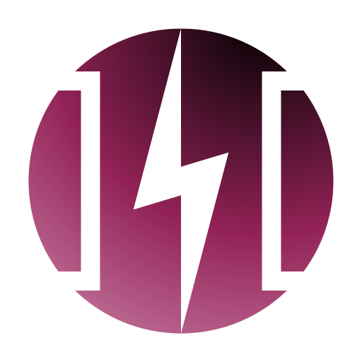

<p align="center"><a href="https://konduit.channel" target="_blank"></a></p>

# Konduit

> A payment network built on Cardano channels.

This project is incubating. Expect sharp edges.

## Vision

An ada holder can have the same experience as a BLN user when paying merchants.

See the [design](./docs/design/) for more details.

## Structure

- [`./connector`](./connector/) - API query layer for Cardano.
- [`./docs`](./docs/) - Meeting notes, adrs, design docs.
- [`./kernel`](./kernel/) - Konuit kernel aka on-chain code. An Aiken repo.
- [`./rust`](./rust/) - Tools for konduit. A rust workspace.

## API Reference(s)

- [Rust & WASM API Reference](https://cardano-lightning.github.io/konduit/rust)

## Contributing

TBC.

## Developing

### Using nix

For the regular Rust/JS/Aiken development environment:

```
$ nix develop
```

For the Cardano local testnet and NixOS deployment tools, use the separate heavy flake:

```
$ nix --extra-experimental-features 'nix-command flakes fetch-closure' develop path:./flake/heavy
```

The heavy flake uses `fetch-closure` through `capkgs`; Nix may also ask to trust
the IOG binary cache configured by that flake.

See [`flake/heavy/README.md`](flake/heavy/README.md) for local testnet and preprod VM instructions.

## Integration testing

In `./packages/integration` there is a test suite that exercises several end-to-end scenarios. To start the required local services, open the heavy shell and run:

In one shell:

```shell
$ nix --extra-experimental-features 'nix-command flakes fetch-closure' develop path:./flake/heavy
$ process-compose-dev-env
```

In another shell:

```shell
$ nix --extra-experimental-features 'nix-command flakes fetch-closure' develop path:./flake/heavy
$ cd packages/integration
$ yarn install
$ vitest --disableConsoleIntercept  --run
```
